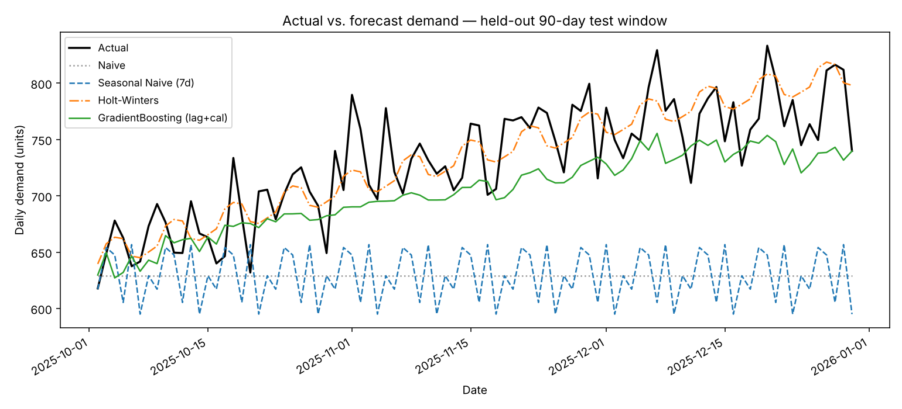

# timeseries-forecast-lab

A small, self-contained research project comparing classical and ML
forecasting approaches on a synthetic daily demand series — with a Go CLI
doing fast, high-volume data generation and validation, and a Python
pipeline doing the statistical research.

This is a **learning/portfolio project**, not a production forecasting
system: the data is synthetic (so the "ground truth" generative process is
known and used to sanity-check the models), the dataset is a single series,
and the evaluation is a single 90-day backtest rather than a rolling
multi-origin evaluation. See [Caveats](#key-findings) below.

## Architecture

A realistic split of responsibilities: a fast, typed, dependency-free Go
program owns data generation/validation (the kind of job that in a real
pipeline would run over many series, many times a day), and Python owns the
statistical modeling and evaluation, where its ecosystem (statsmodels,
scikit-learn) does the heavy lifting.

```
┌─────────────────────────┐        ┌──────────────────────────────────────┐
│   datagen/ (Go)          │        │   analysis/ (Python)                  │
│                          │  CSV   │                                        │
│  synthetic series   ───────────▶  │  load → train/test split (last 90d)   │
│  (trend + weekly +      │        │       → fit 3 forecasters             │
│   yearly + noise)       │        │       → MAE / RMSE / MAPE             │
│                          │        │       → actual-vs-predicted plot      │
│  -validate: schema,     │        │       → training-window ablation      │
│  gaps, negative values  │        │                                        │
└─────────────────────────┘        └──────────────────────────────────────┘
      data/demand.csv  ◀──writes────────── read by forecast_lib.load_series
```

## Repository layout

```
timeseries-forecast-lab/
├── datagen/              Go CLI: synthetic data generator + validator
│   ├── main.go           CLI entry point (flags, CSV writer)
│   ├── generator.go      generative model (documented in its doc comment)
│   ├── validate.go       CSV data-quality checks
│   ├── generator_test.go unit tests (statistical properties)
│   └── go.mod
├── data/
│   └── demand.csv        output of `datagen`, read by the Python pipeline
├── analysis/
│   ├── forecast_lib.py   baselines, Holt-Winters, GBM feature engineering
│   ├── run_analysis.py   end-to-end run: fit, score, plot, ablate
│   └── results/          CSV/JSON outputs from the last run (committed)
├── plots/
│   └── actual_vs_predicted.png
├── requirements.txt
├── LICENSE
└── README.md
```

## How to run

### 1. Generate and validate the data (Go)

```bash
cd datagen
go build -o datagen .
./datagen -out ../data/demand.csv -days 1095 -start 2023-01-01 -seed 42 -validate
go test ./... -v
```

This writes 1,095 days (3 years) of daily demand to `data/demand.csv` and
runs the validation report (schema, missing/duplicate dates, negative
values) inline. `go test` runs 5 unit tests covering output shape,
non-negativity, date contiguity, determinism, and that the weekly/yearly
seasonal signal is actually present in the output.

### 2. Run the forecasting research (Python)

```bash
python3 -m venv .venv && source .venv/bin/activate
pip install -r requirements.txt
cd analysis
python run_analysis.py
```

Runs in well under a minute. Writes `analysis/results/*.csv` and
`plots/actual_vs_predicted.png`.

## Data

3 years of daily synthetic demand (2023-01-01 to 2025-12-30, 1,095 rows),
generated by `datagen` with: base level 500, linear trend +0.12/day, weekly
seasonality amplitude 60 (weekend peaks, midweek trough), yearly seasonality
amplitude 150 (cosine, peaking late December), Gaussian noise (σ=25). The
exact model is documented in `datagen/generator.go`.

## Results

Held-out test window: **last 90 days** of the series. All numbers below are
from an actual run of `analysis/run_analysis.py` against `data/demand.csv`
(see `analysis/results/model_comparison.csv`).

| Model                        |   MAE  |  RMSE  | MAPE (%) | Fit time (s) |
|-------------------------------|-------:|-------:|---------:|-------------:|
| **Holt-Winters**               | **21.96** | **27.88** | **3.02** | 1.22 |
| GradientBoosting (lag+cal)     | 33.74  | 40.94  | 4.49     | 4.21 |
| Naive                          | 102.47 | 114.00 | 13.60    | 0.00 |
| Seasonal Naive (7d)            | 103.28 | 115.90 | 13.73    | 0.00 |



### Ablation: training window length

How test-set error changes as the Holt-Winters and gradient-boosting models
are given less training history (test window fixed at the same 90 days;
see `analysis/results/window_ablation.csv`):

| Train window (days) | HW MAE | HW RMSE | GBM MAE | GBM RMSE |
|---------------------:|-------:|--------:|--------:|---------:|
| 120                  | 22.40  | 28.30   | 118.26  | 131.97   |
| 240                  | 22.29  | 27.67   | 99.98   | 111.62   |
| 365                  | 27.93  | 34.29   | 83.45   | 92.53    |
| 545                  | 23.27  | 28.23   | 49.13   | 57.26    |
| 730                  | 22.35  | 27.39   | 28.02   | 35.18    |
| 1005 (full)          | 21.96  | 27.88   | 33.74   | 40.94    |

## Key findings

- **Holt-Winters won decisively** on this series (RMSE 27.9 vs. 40.9 for
  gradient boosting, both far ahead of the naive baselines at ~115). That is
  not surprising given the data: the generative process is a clean additive
  trend + weekly seasonality + yearly seasonality model, which is exactly
  what exponential smoothing with a damped trend and a 7-day seasonal
  component is built to fit. This result says more about the match between
  model and data-generating process than it does about Holt-Winters being
  "better" in general.
- **The gradient-boosting model is far more sensitive to training window
  length than Holt-Winters.** HW's RMSE stays in a tight 27–34 band
  regardless of how much history it sees (120 to 1,005 days), because it
  only needs to estimate a handful of smoothing/seasonal parameters. The GBM
  model's RMSE falls sharply as window length grows from 120→730 days
  (132→35) because it needs enough examples, and enough repetitions of the
  yearly cycle, to learn calendar-based seasonal patterns from trees rather
  than being told the structure directly — interesting since 1,095 days is
  only 3 trips around the yearly cycle.
- **The 1,005-day (full-history) GBM result is slightly worse than the
  730-day result** (RMSE 40.9 vs 35.2). This is a real, reproducible
  artifact of this run, not noise we smoothed over: with only 3 years of
  data, "more history" also means more early-period noise realizations the
  trees can key into, and only a few more drawn seasonal cycles to average
  over. It is a useful caution against assuming "more training data is
  strictly better" without checking.
- Both baselines (naive, seasonal-naive) are roughly 4x worse than the
  tuned models on every metric, which is the expected sanity check — if
  SARIMA/HW/GBM couldn't beat a seasonal-naive forecast here, something
  would be wrong with the pipeline.

**Caveats / honesty check:** this is a single synthetic series with one
train/test split, so none of the above is statistically significant in the
sense of generalizing to other series or real-world demand data (which has
promotions, stockouts, holidays with shifting dates, and regime changes that
this generator doesn't model). The GBM forecast is produced recursively
(each day's prediction feeds the lag features for later days), which is the
honest way to backtest multi-step forecasts but also means its errors can
compound — a likely contributor to it losing to Holt-Winters here. A fairer
comparison would use multiple train/test splits (rolling-origin
cross-validation) and multiple independently generated series.

## Future work

- Rolling-origin (walk-forward) cross-validation instead of a single
  90-day holdout, to get error bars on the comparison.
- A SARIMA model with explicit yearly seasonal terms (or Fourier terms as
  SARIMAX exogenous regressors) to give the classical family a fair shot at
  the yearly component, which plain 7-day-period Holt-Winters doesn't model
  directly.
- Generate multiple synthetic series with varying noise levels and
  seasonality strength in the Go tool, and report comparison results
  aggregated across all of them rather than one series.
- Add holidays / promotions / occasional stockouts (zero-inflated days) to
  the Go generator to make the series less "clean" and more representative
  of real retail data, then re-run the comparison.
- Hyperparameter search for the GBM model (currently fixed
  `n_estimators=300, max_depth=3, learning_rate=0.05`) and a comparison
  against LightGBM/XGBoost.

## License

MIT — see [LICENSE](LICENSE). Copyright (c) 2026 Jai Indra Reddy Jonnala.
